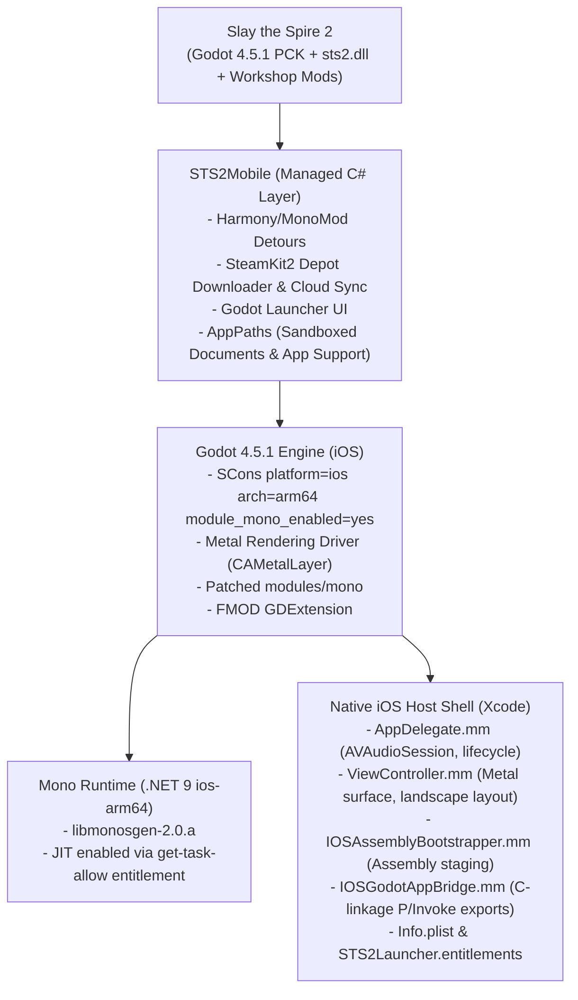

# Slay the Spire 2 iOS Port Roadmap (JIT-Enabled Sideloading)

This roadmap documents the architectural strategy, phase breakdown, and execution status for porting the Slay the Spire 2 mobile launcher from Android to iOS.

---

## Architecture Overview

---

## Phase Breakdown & Tracking

### Phase 1: Environment, Host Shell & Toolchain Setup `[COMPLETED]`
- [x] Create iOS project directory structure under `ios/STS2Launcher`.
- [x] Create `ios/STS2Launcher.xcodeproj/project.pbxproj` configured for iOS 15.0+ arm64 deployment.
- [x] Implement `AppDelegate.h`/`.mm` with `AVAudioSessionCategoryPlayback` (ambient mix enabled).
- [x] Implement `ViewController.h`/`.mm` with `CAMetalLayer` and auto-hiding home indicator.
- [x] Implement `IOSAssemblyBootstrapper.h`/`.mm` to stage BCL and assemblies into `~/Library/Application Support/.godot/mono/publish/arm64`.
- [x] Implement `IOSGodotAppBridge.h`/`.mm` with C-linkage exports (`ios_share_text_file`, `ios_get_usable_space_bytes`, `ios_get_device_diagnostics`, `ios_get_version_name`, `ios_set_keep_screen_on`, `ios_get_safe_area_insets`, `ios_get_documents_dir`, `ios_restart_app`).
- [x] Configure `Info.plist` with `UIFileSharingEnabled` (Files app integration), `LSSupportsOpeningDocumentsInPlace`, and `NSAllowsArbitraryLoads`.
- [x] Configure `STS2Launcher.entitlements` with `get-task-allow = true` and `dynamic-codesigning = true` for JIT sideloading.
- [x] Update `patches/godot/sts2-android-runtime.patch` to support both `ANDROID_ENABLED` and `IOS_ENABLED`.
- [x] Update `scripts/make-bootstrap-pck.py` to support custom output targets.
- [x] Create iOS build scripts: `scripts/build-godot-ios.sh`, `scripts/build-ios-mono.sh`, and `scripts/build-ios-local.sh`.
- [x] Create `.github/workflows/build-ios.yml` for automated CI on `macos-14` (Apple Silicon).
- [x] Update `.gitignore` for iOS build outputs, `.ipa`, `.xcarchive`, and Xcode schemes.

---

### Phase 2: Engine & Native Runtime Compilation `[COMPLETED]`
- [x] SCons iOS build script (`scripts/build-godot-ios.sh`) prepared.
- [x] CMake Mono `ios-arm64` build script (`scripts/build-ios-mono.sh`) prepared.
- [x] Run Godot 4.5.1 iOS arm64 build and verify `libgodot.ios.template_release.arm64.a`.
- [x] Run Mono .NET 9 iOS arm64 build and verify `libmonosgen-2.0.a`.
- [x] Link `libgodot.a` and `libmonosgen-2.0.a` into `ios/libs/`.

---

### Phase 3: Native Host Shell & Lifecycle `[COMPLETED]`
- [x] Assembly staging logic from bundle resources to sandbox user directory.
- [x] Documents directory preparation (`Documents/StS2Launcher/Mods`) for direct file management via iOS Files app.
- [x] Native share sheet integration (`UIActivityViewController`).
- [x] Screen wake lock controller (`[UIApplication sharedApplication].idleTimerDisabled`).

---

### Phase 4: Audio Middleware & Native GDExtensions (FMOD & Spine for iOS) `[COMPLETED]`
- [x] Obtain FMOD Studio Engine for iOS (`libfmod_iphoneos.a`, `libfmodstudio_iphoneos.a`) and `utopia-rise/fmod-gdextension` `6.1.0-4.5.0` (`libGodotFmod.ios.template_release.xcframework`).
- [x] Stage and link FMOD static libraries (`ios/libs/`) and `libGodotFmod.ios.template_release.universal.framework` + `libspine_godot.ios.template_release.framework` (`4.2` for Godot `4.5.1-stable`) into the Xcode project and `.app/Frameworks/` bundle.
- [x] Register `fmod_library_init` and `spine_godot_library_init` with Godot's `OS_AppleEmbedded` dynamic symbol lookup table and export `load_all_fmod_plugins` + `AVAudioSessionInterruptionNotification` recovery in `AppDelegate.mm`.
- [x] Confirm PCK patcher (`DepotDownloader.PckPatch.cs` and `LocalPckRepairOperation.cs`) configures `FmodManager`, `fmod.gdextension`, and `res://banks/desktop/*.bank` on arm64/iOS (`STS2Mobile.GameIdentityTests`: 220/220 passed).

---

### Phase 5: Managed Layer Adaptations (`STS2Mobile` C#) `[COMPLETED]`
- [x] **`AppPaths.cs`**:
  - Added `OperatingSystem.IsIOS()` detection.
  - Mapped `ExternalModsDir` to `Documents/StS2Launcher/Mods` (user accessible via iOS Files app).
  - Bypassed Android storage permission checks (`HasStoragePermission()` returns `true`).
  - Routed private data directory to iOS Application Support via `IOSGodotAppBridge.GetUserDataDir()`.
- [x] **Bridge Integration**:
  - Implemented `IOSGodotAppBridge.cs` in managed C# using `[DllImport("__Internal")]` to bind to native C functions.
  - Connected `LauncherSharedTextFile.cs` to `IOSGodotAppBridge.ShareTextFile`.
  - Connected `LauncherDiagnostics.cs` to iOS device diagnostics and Documents directory.
  - Connected `DepotDownloader.FileSystem.cs` to `IOSGodotAppBridge.GetUsableSpaceBytes`.
  - Added download screen keep-awake toggle (`IOSGodotAppBridge.SetKeepScreenOn(true/false)`) in `DepotDownloader.cs`.
  - Routed restart calls in `LauncherModel.Launch.cs`, `AppLifecyclePatches.cs`, and `LauncherStartupRecoveryControlPanel` to `IOSGodotAppBridge.RestartApp()`.
- [x] **Managed Build Manifests**:
  - Updated `STS2Mobile.csproj` to support both `ios/assets/dotnet_bcl` and `android/assets/dotnet_bcl` build manifests.

---

### Phase 6: Steam Download & PCK Patching Pipeline `[PENDING]`
- [ ] Test `SteamKit2` depot download on iOS (TLS / WebSocket socket performance).
- [ ] Verify `DepotDownloader.PckPatch.cs` patches `SlayTheSpire2.pck` cleanly on iOS.
- [ ] Test Steam Cloud save upload/download over mobile connection.

---

### Phase 7: Sideloading Packaging & Device Acceptance `[IN PROGRESS]`
- [x] Generate `.ipa` package using `scripts/build-ios-local.sh` or GitHub Actions.
- [ ] Sideload onto iPhone via AltStore (enable AltJIT) or SideStore (enable SideJIT).
- [ ] Verify standalone launcher startup on physical device.
- [ ] Verify Steam login, depot download, and PCK patch execution.
- [ ] Verify game boot, touch input, audio playback (FMOD), and Cloud save sync.
